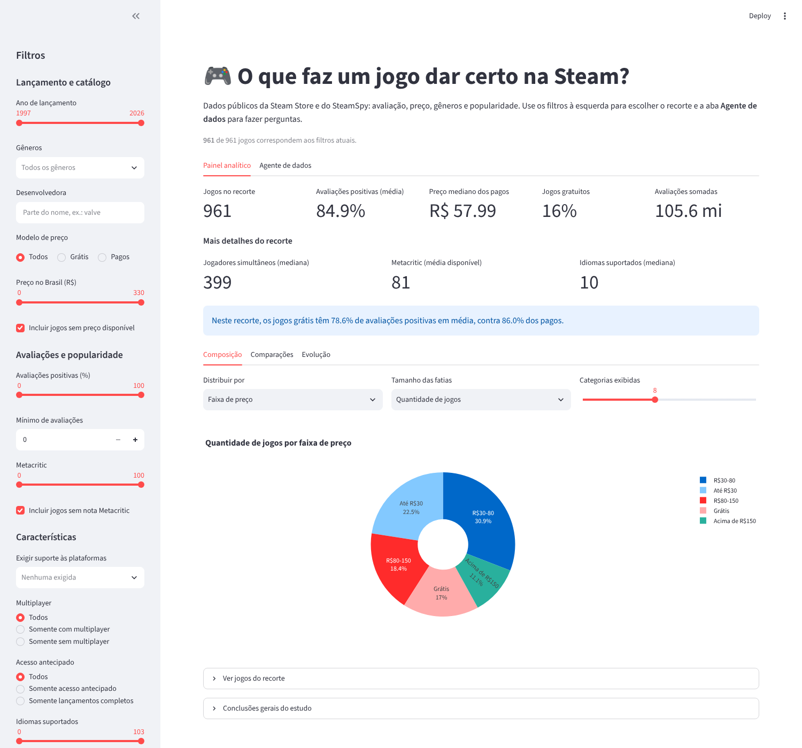
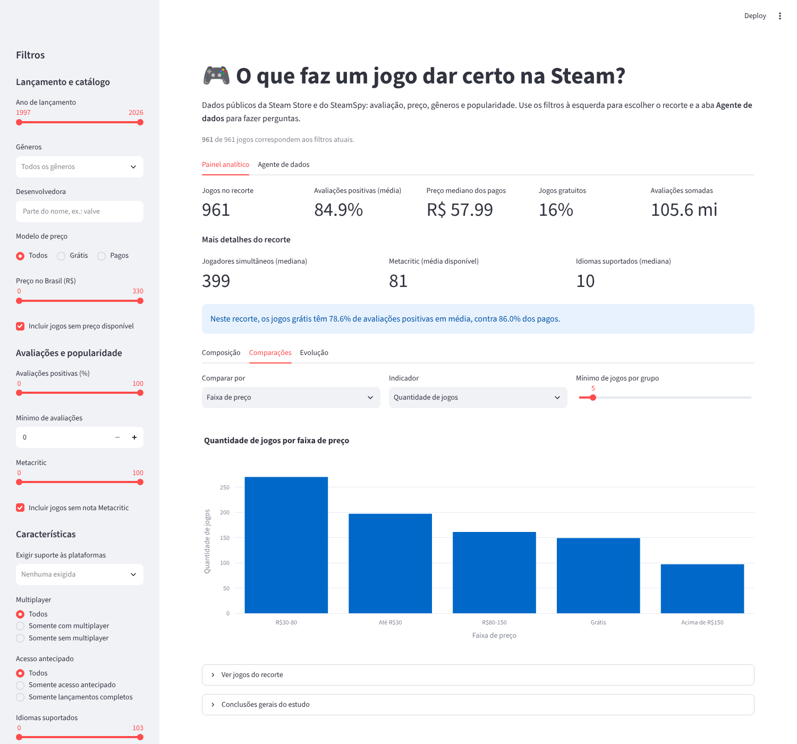
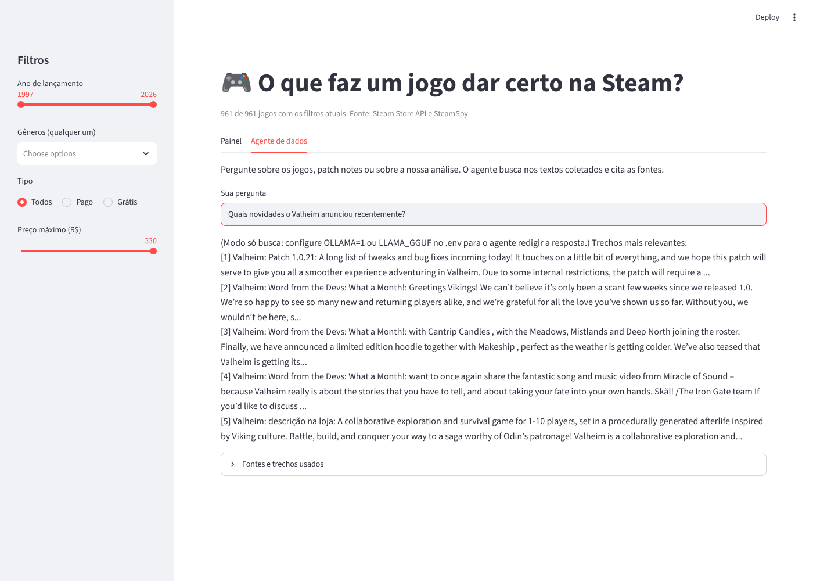

# O que faz um jogo dar certo na Steam?
### Relatório do Projeto Final de Ciência de Dados

**Integrantes:** [nomes]   **Curso/Turma:** [ ]   **Professor(a):** [ ]   **Data:** [ ]

> Os números deste relatório vêm da coleta feita em 03/11/2026. Se o grupo rodar a coleta de novo, os valores mudam um pouco. Nesse caso, rode `eda.py` e `ml.py` de novo e confira os números em `docs/resultados_eda.md` e `docs/resultados_ml.md`.

---

## 1. Introdução
A Steam, loja de jogos da Valve, é a principal plataforma de distribuição de jogos para computador, com dezenas de milhares de títulos à venda. Em cada página de jogo a loja mostra a avaliação dos usuários (a porcentagem de análises positivas), que funciona como um selo de qualidade para quem está decidindo o que comprar.

Este projeto investiga quais características dos jogos acompanham uma boa avaliação e uma base maior de jogadores. Para isso, coletamos dados públicos de 961 jogos pela API da Steam e pelo SteamSpy, tratamos e analisamos a base com estatística descritiva, testes e Machine Learning, e apresentamos os resultados em um painel interativo e em um agente de dados com RAG, que responde perguntas sobre os jogos e sobre a própria análise.

**Pergunta principal:** quais características de um jogo vendido na Steam (preço, gratuidade, gêneros, plataformas, idiomas, ano de lançamento) estão associadas a uma melhor avaliação dos jogadores e a uma base maior de usuários?

## 2. Justificativa
O volume de lançamentos na Steam torna difícil para um jogo ser notado. A avaliação dos usuários afeta diretamente a decisão de compra e a visibilidade na loja. Saber quais características acompanham jogos bem avaliados ajuda:
- **desenvolvedores independentes e publicadoras** a decidir preço, modelo (gratuito ou pago), gêneros e plataformas;
- **jogadores** a interpretar a nota que veem na loja;
- **estudantes e pesquisadores** a ter um exemplo completo de projeto de dados com fontes públicas e atualizadas.

O tema é viável porque os dados são públicos, acessíveis por API sem custo e há textos oficiais (anúncios e patch notes) para alimentar o agente de dados.

## 3. Objetivos
**Objetivo geral:** analisar dados públicos da Steam para identificar fatores associados à avaliação e à popularidade dos jogos, e apresentar os resultados em um painel interativo e em um agente de dados.

**Objetivos específicos:**
1. Coletar dados de jogos pela Store API da Steam e pelo SteamSpy.
2. Tratar e documentar a base, com dicionário de dados.
3. Descrever a base com estatística descritiva e comparar grupos (grátis × pago, gêneros, faixas de preço, anos).
4. Medir a correlação entre as variáveis e a proporção de avaliações positivas.
5. Avaliar se é possível prever, com Machine Learning, se um jogo terá 80% ou mais de avaliações positivas.
6. Construir um painel com indicadores e filtros.
7. Montar um agente RAG que responda perguntas usando notícias oficiais, descrições dos jogos e os resultados do grupo.

## 4. Metodologia
O projeto seguiu um pipeline em Python, com um script para cada etapa, executados nesta ordem:

| Etapa | Script | O que faz |
|---|---|---|
| Coleta | `src/coleta.py` | SteamSpy (lista e avaliações), Store API (detalhes) e Steam News (textos) |
| Tratamento | `src/tratamento.py` | junção das fontes, filtros, variáveis derivadas |
| Dicionário | `src/dicionario.py` | documentação das colunas |
| Análise | `src/eda.py` | estatística descritiva, testes, correlação, gráficos |
| Machine Learning | `src/ml.py` | classificação e clusterização |
| Banco vetorial | `src/vetorial.py` | limpeza dos textos, chunks, embeddings, PostgreSQL + pgvector |
| Agente | `src/agente_rag.py` | busca híbrida + LLM |
| Painel | `app/painel.py` | Streamlit com filtros, gráficos e aba do agente |

- **Fonte dos dados estruturados:** Steam Store API (`appdetails`) e SteamSpy (`request=all`).
- **Fonte dos textos do agente:** Steam News API (`ISteamNews/GetNewsForApp`, apenas anúncios oficiais), descrições da Store API e os achados da análise do grupo.
- **Tratamentos:** descritos na seção 6.
- **Técnicas estatísticas:** média, mediana, mínimo, máximo, desvio padrão, assimetria, teste de Mann-Whitney e correlação de Spearman. Usamos testes não paramétricos porque a proporção de avaliações positivas não segue distribuição normal (assimetria de −1,53).
- **Painel:** Streamlit com Plotly.
- **Agente:** embeddings `paraphrase-multilingual-MiniLM-L12-v2`, banco vetorial PostgreSQL com pgvector e LLM local Qwen2.5-7B (Ollama), sem API externa.
- **Ferramentas:** Python 3, pandas, NumPy, SciPy, Matplotlib, Seaborn, scikit-learn, Plotly, Streamlit, sentence-transformers, PostgreSQL, pgvector, Docker, Ollama e GitHub.

## 5. Descrição da base de dados
- **Recorte:** os 1000 jogos com mais donos estimados segundo o SteamSpy (página 0 do endpoint `all`). Para cada um, buscamos os detalhes na Store API com preços da loja brasileira (`cc=br`).
- **Base final:** 961 jogos e 35 colunas, lançados entre 1997 e 2026.
- **Principais variáveis:** preço em reais, gratuidade, gêneros, categorias, data de lançamento, plataformas, número de idiomas, nota Metacritic, conquistas, DLCs, avaliações positivas e negativas, faixa de donos e pico de jogadores simultâneos.
- **Variável de interesse:** `prop_positiva`, a proporção de avaliações positivas (positivas ÷ total).
- **Dicionário de dados:** `docs/dicionario_dados.md`, com tipo, descrição, exemplo, % de nulos e origem de cada coluna.

Limitação importante: a amostra é formada pelos jogos mais populares da Steam, não por todos os jogos. Os resultados valem para esse recorte.

## 6. Tratamento dos dados
| Passo | Linhas |
|---|---|
| Jogos com detalhes retornados pela Store API | 987 |
| Remoção de duplicados | 978 |
| Apenas tipo "game" (sem DLC, software, demo) | 978 |
| Data de lançamento válida | 966 |
| Pelo menos 50 avaliações (para a proporção ser estável) | **961** |

Outras decisões:
- A Store API foi consultada em inglês (`l=english`) para as datas virem no formato "21 Aug, 2012", que o pandas converte. Em português elas viriam como "21 ago. 2012", e todas ficariam vazias.
- Preços vêm em centavos e foram divididos por 100. Jogos gratuitos ficaram com preço 0. Os 87 jogos pagos que não estão à venda no Brasil ficaram com preço vazio, em vez de 0, para não serem confundidos com gratuitos.
- **Variáveis derivadas:** ano de lançamento, idade do jogo, total de avaliações, proporção positiva, donos (limite inferior e ponto médio da faixa), número de gêneros, multijogador, acesso antecipado, faixa de preço e classificação no padrão da Steam.
- O SteamSpy hoje devolve tempo de jogo igual a 0 para todos os jogos. Por isso essa variável foi descartada e usamos o pico de jogadores simultâneos como medida de popularidade.
- **Nulos restantes:** Metacritic (417 jogos sem nota, porque nem todo jogo é avaliado pela crítica) e preço (os 87 fora de venda no Brasil). Esses nulos foram mantidos e tratados em cada análise.

## 7. Análise exploratória e estatística
**Registros:** 961 jogos, dos quais 149 (16%) gratuitos e 725 pagos com preço no Brasil.

**Estatística descritiva**

| Variável | n | Média | Mediana | Mín. | Máx. | Desvio padrão |
|---|---|---|---|---|---|---|
| Preço (R$), jogos pagos | 725 | 75,95 | 57,99 | - | 329,90 | - |
| % de avaliações positivas | 961 | 84,9% | 88,4% | 16% | 99% | 11,9 p.p. |
| Nº de avaliações | 961 | 109.865 | 44.497 | 91 | 8.815.087 | 341.392 |
| Jogadores simultâneos | 961 | 4.896 | 399 | 0 | 1.013.936 | 35.967 |
| Nº de idiomas | 961 | 10,7 | 10 | 1 | 103 | 7,5 |
| Metacritic | 544 | 80,6 | 82 | 43 | 97 | 8,2 |

**Distribuição.** A avaliação é concentrada nos valores altos (assimetria de −1,53): pela classificação da Steam, 534 jogos são "Muito positivos", 174 "Extremamente positivos", 139 "Positivos", 110 "Mistos" e apenas 4 "Negativos". Isso é esperado, porque jogos muito mal avaliados raramente chegam ao grupo dos mais populares. Número de avaliações e de jogadores têm média muito maior que a mediana: poucos jogos gigantes (Counter-Strike 2, PUBG, GTA V) puxam a média para cima. Por isso a mediana é a medida mais representativa para essas variáveis. *(Figuras 01 e 02)*

**Grátis × pago.** Jogos gratuitos têm em média 78,6% de avaliações positivas, contra 86,0% dos pagos. O teste de Mann-Whitney deu p < 0,001, então a diferença é estatisticamente significativa. Em popularidade, os gratuitos têm mediana de 496 jogadores simultâneos, contra 381 dos pagos. *(Figura 03)*

**Gêneros (com 15 ou mais jogos).** Os mais bem avaliados são Indie (88,2%, 353 jogos), Casual (86,1%), Simulation (85,8%), Strategy (85,3%) e Adventure (85,2%). Os piores são Early Access (76,3%), Free To Play (76,2%), Sports (74,7%) e Massively Multiplayer (73,3%). *(Figura 04)*

**Faixa de preço.** A avaliação média é de 78,6% nos grátis, 87,4% até R$30, 89,4% entre R$30 e R$80, 86,5% entre R$80 e R$150 e 83,9% acima de R$150. A relação não é linear: a avaliação sobe da faixa grátis até a intermediária e cai nas faixas mais caras. *(Figura 05)*

**Ano de lançamento.** A média cai de 90,1% (jogos até 2010) para 85,5% (2011–2015), 84,0% (2016–2020) e 83,0% (2021 em diante). *(Figura 06)*

**Multijogador.** Jogos com modo multijogador ou online têm média de 82,6%, contra 88,8% dos que não têm.

**Correlação de Spearman com a % positiva** *(Figura 07)*

| Variável | ρ |
|---|---|
| Nota Metacritic | +0,45 |
| Nº de avaliações | +0,31 |
| Jogadores simultâneos | +0,20 |
| Preço | +0,10 |
| Nº de idiomas | +0,07 |
| Desconto | +0,03 |
| Nº de conquistas | +0,01 |
| Ano de lançamento | −0,10 |

A única correlação moderada é com a nota da crítica: crítica e jogadores tendem a concordar, mas não totalmente. *(Figura 08)* As demais são fracas, ou seja, nenhuma característica isolada explica bem a avaliação.

## 8. Machine Learning
**Problema:** classificação binária. Dado um jogo, prever se ele terá 80% ou mais de avaliações positivas (77% dos jogos estão nessa classe).

**Features (24):** preço, gratuito, número de idiomas, número de gêneros, multijogador, ano de lançamento, Mac, Linux, conquistas, DLCs, idade mínima, suporte a controle, cooperativo e 11 indicadores de gênero. Não usamos avaliações, número de avaliações nem recomendações como entrada, porque elas são o próprio resultado e causariam vazamento de dados.

**Método:** 75% dos dados para treino e 25% para teste (estratificado), validação cruzada de 5 partes no treino, `class_weight="balanced"` para lidar com o desbalanceamento das classes e comparação com um baseline.

| Modelo | F1 macro (CV) | Acurácia | Precisão | Recall | F1 macro | ROC AUC |
|---|---|---|---|---|---|---|
| Baseline (chuta a classe mais comum) | 0,44 | 0,77 | 0,77 | 1,00 | 0,44 | 0,50 |
| Regressão Logística | 0,59 | 0,69 | 0,87 | 0,70 | 0,63 | 0,77 |
| **Random Forest** | **0,65** | **0,75** | 0,87 | **0,79** | **0,68** | 0,77 |

**Interpretação.** O baseline tem 77% de acurácia sem aprender nada, por isso usamos F1 macro e ROC AUC, que consideram as duas classes. O Random Forest foi o melhor modelo: F1 macro de 0,68 contra 0,44 do baseline. Ele acerta 60% dos jogos com menos de 80% de positivas, que o baseline nunca acerta. Ainda assim, o desempenho é moderado. As características da loja ajudam a prever, mas a qualidade percebida de um jogo depende de fatores que não estão na base (jogabilidade, bugs, comunidade, preço justo). *(Figura 09)*

**Variáveis mais importantes:** preço (0,17), número de conquistas (0,10), ano de lançamento (0,10), número de idiomas (0,09) e número de DLCs (0,07). Importância alta mostra que a variável ajuda a separar as classes, não que ela causa uma boa avaliação. *(Figura 10)*

**Clusterização (extra).** O K-Means com 4 grupos (variáveis em escala log e padronizadas) encontrou estes perfis:

| Perfil | Jogos | Preço médio | Jogadores (mediana) | % positivas | Leitura |
|---|---|---|---|---|---|
| 0 | 299 | R$ 106 | 2.464 | 89% | grandes sucessos pagos, muitos idiomas e conquistas (Terraria, Rust) |
| 3 | 299 | R$ 63 | 173 | 87% | jogos pagos tradicionais, hoje com poucos jogadores simultâneos (BioShock Infinite, Tomb Raider) |
| 1 | 157 | R$ 27 | 89 | 87% | jogos baratos e de nicho, poucos idiomas e sem conquistas (Unturned, Lethal Company) |
| 2 | 119 | R$ 3 | 656 | 74% | gratuitos e multijogador competitivos, muito jogados e pior avaliados (Counter-Strike 2, PUBG, Rainbow Six Siege) |

*(Figura 11)*

## 9. Painel analítico
Feito em Streamlit (`app/painel.py`). Para abrir: `streamlit run app/painel.py`.
O passo a passo de cada tela está em `docs/guia_do_sistema.md`.
- **Filtros (barra lateral), em três grupos:**
  - lançamento e catálogo: ano, gêneros, desenvolvedora, modelo de preço (grátis/pago), faixa de preço no Brasil e jogos sem preço;
  - avaliações e popularidade: % de positivas, mínimo de avaliações e nota Metacritic;
  - características: plataformas exigidas, multiplayer, acesso antecipado e número de idiomas.

  Todos os indicadores e gráficos respondem aos filtros.
- **Indicadores:** jogos no recorte, % de positivas média, preço mediano dos pagos, % de gratuitos e total de avaliações. Também mostra a mediana de jogadores simultâneos, o Metacritic médio, a mediana de idiomas e uma comparação automática entre jogos grátis e pagos.
- **Gráficos, em três abas:**
  - **Composição (pizza):** distribuição por faixa de preço, gênero, perfil de avaliação, modelo de preço, multiplayer ou plataforma;
  - **Comparações (colunas):** quantidade, avaliação média, jogadores simultâneos ou preço mediano por grupo, com mínimo de jogos por grupo;
  - **Evolução (linhas):** o indicador escolhido ao longo dos anos de lançamento.
- **Tabela:** todos os jogos do recorte, ordenáveis por avaliações, jogadores, preço, Metacritic ou ano.
- **Conclusões gerais:** os achados da análise em texto.
- **Aba "Agente de dados":** o agente RAG dentro do mesmo painel.







## 10. Agente de dados com RAG
**Coleta de textos (tabela 9.1).** Foram coletados 1.329 documentos. A lista completa, com documento, fonte, link, data de acesso e tema, está em `docs/tabela_documentos.csv`.

| Tipo de documento | Qtd. | Fonte | Tema |
|---|---|---|---|
| Notícias e patch notes oficiais (80 jogos mais avaliados) | 362 | Steam News API, feed de anúncios oficiais | atualizações e novidades |
| Descrição de cada jogo | 955 | Steam Store API | o que é o jogo |
| Achados da análise do grupo | 12 | este projeto | estatística e ML |

Exemplos para o corpo do relatório:

| Documento | Fonte | Link | Data de acesso | Tema |
|---|---|---|---|---|
| Counter-Strike 2: Counter-Strike 2 Update | Steam - anúncios oficiais | (link em tabela_documentos.csv) | 03/11/2026 | Patch notes |
| Valheim: Patch 1.0.21 | Steam - anúncios oficiais | (link em tabela_documentos.csv) | 03/11/2026 | Patch notes |
| Terraria: descrição na loja | Steam Store | https://store.steampowered.com/app/105600 | 03/11/2026 | Descrição do jogo |

**Preparação.**
1. Extração do JSON das APIs.
2. Limpeza de HTML, BBCode, links e entidades.
3. Descarte de textos com menos de 30 palavras.
4. Divisão em chunks de 300 palavras com sobreposição de 50, resultando em 2.724 chunks.
5. Metadados em cada chunk: título, fonte, link, data, tema e jogo.

**Embeddings e banco vetorial.** Usamos o modelo `paraphrase-multilingual-MiniLM-L12-v2`, que é gratuito, roda localmente e entende português e inglês. Isso importa porque as perguntas são em português e os patch notes em inglês. O título é concatenado ao texto antes de gerar o embedding. Os chunks ficam no PostgreSQL 16 com a extensão **pgvector**, que roda num container Docker (`docker-compose.yml`). Cada chunk é uma linha da tabela `documentos`:

| Coluna | Tipo | Conteúdo |
|---|---|---|
| id | TEXT | identificador do chunk |
| titulo, fonte, link, data, tema, jogo | TEXT | metadados |
| texto | TEXT | o trecho |
| embedding | VECTOR(384) | o vetor gerado pelo modelo |

Há um índice HNSW na coluna `embedding` (distância cosseno) e um índice comum em `jogo`. Com isso, a busca leva cerca de 3 ms. A troca do ChromaDB, usado no início, pelo pgvector foi feita a pedido do professor. Conferimos que as 5 perguntas de teste recuperam exatamente as mesmas fontes nos dois bancos.

**Funcionamento.**
1. A pergunta vira embedding.
2. Se ela cita um jogo da base, a busca é filtrada pelos textos daquele jogo.
3. O PostgreSQL devolve os 20 trechos mais próximos com uma consulta SQL:
   ```sql
   SELECT titulo, fonte, link, data, texto, embedding <=> :pergunta AS distancia
   FROM documentos
   WHERE :jogo IS NULL OR jogo = :jogo
   ORDER BY distancia
   LIMIT 20;
   ```
4. Uma reordenação híbrida soma à similaridade um bônus pelas palavras da pergunta presentes no trecho. Sem essa etapa, a pergunta sobre "a variável que mais pesou no modelo" recuperava o achado errado.
5. Os 5 melhores trechos vão para o LLM local (Qwen2.5-7B, via Ollama), instruído a responder em português, só com base nos trechos, citando [1], [2]... e dizendo quando não encontrar a resposta.

**Perguntas de teste** (resultado completo da busca em `docs/teste_agente_modo_busca.txt`):

| # | Pergunta | Trecho recuperado em 1º lugar | Correto? |
|---|---|---|---|
| 1 | O que mudou na atualização mais recente do Counter-Strike 2? | patch notes oficiais do CS2 (out/2026) | sim |
| 2 | Jogos gratuitos são mais bem avaliados que os pagos? | achado "grátis × pago" | sim |
| 3 | Quais gêneros têm a melhor avaliação dos jogadores? | achado "gêneros" | sim |
| 4 | Quais novidades o Valheim anunciou recentemente? | Patch 1.0.21 do Valheim | sim |
| 5 | Qual variável mais pesou no modelo que prevê se um jogo será bem avaliado? | achado "variáveis mais importantes" | sim |

**Respostas redigidas pelo agente** (busca no PostgreSQL/pgvector + modelo local Qwen2.5-7B, sem internet nem chave de API; saída completa em `docs/teste_agente_respostas.txt`):

**1. O que mudou na atualização mais recente do Counter-Strike 2?**
> Na atualização publicada em 28/10/2026 foi adicionada uma opção para alternar o Modo de Recarga Silenciosa entre *Hold* e *Toggle*; com o Toggle, depois que a recarga silenciosa começa, é possível soltar o botão. Também foram corrigidos casos em que o primeiro som da recarga era audível mesmo na recarga silenciosa. [5]

**2. Jogos gratuitos são mais bem avaliados que os pagos?**
> Não. Os jogos gratuitos têm em média 78,6% de avaliações positivas, contra 86,0% dos pagos, e a diferença é estatisticamente significativa. [1]

**3. Quais gêneros têm a melhor avaliação dos jogadores?**
> Indie (88,2%, 353 jogos), Casual (86,1%, 120), Simulation (85,8%, 192), Strategy (85,3%, 192) e Adventure (85,2%, 372). [1]

**4. Quais novidades o Valheim anunciou recentemente?**
> O patch 1.0.21, com uma lista de ajustes e correções [1]; uma turnê de concertos com a trilha do jogo, começando por Estocolmo e Paris [2][3]; uma história em quadrinhos [3]; e produtos oficiais, como camiseta limitada, cobertor e réplicas de escudos [2][3].

**5. Qual variável mais pesou no modelo que prevê se um jogo será bem avaliado?**
> O preço, com importância de 0,17 no Random Forest. [1]

**Avaliação:** as cinco respostas estão corretas e citam a fonte certa. Na pergunta 2 o modelo escreveu uma frase confusa antes de concluir corretamente; na pergunta 5 ele não repetiu a ressalva do achado (importância não indica se a variável aumenta ou diminui a avaliação). Por isso o painel mostra os trechos usados junto da resposta, para o usuário conferir.

## 11. Interpretação dos resultados
1. **Ser gratuito não garante boa avaliação.** Os gratuitos são mais jogados ao mesmo tempo, mas têm avaliação significativamente menor (78,6% × 86,0%). Uma explicação plausível é que jogos gratuitos são em geral multijogador competitivos com microtransações, um modelo que gera mais reclamações. O gênero Massively Multiplayer e o perfil 2 da clusterização reforçam essa leitura.
2. **Preço tem relação fraca e não linear com a avaliação.** A faixa de R$30 a R$80 é a mais bem avaliada. Jogos muito caros não são mais bem avaliados, provavelmente porque a expectativa do jogador é maior.
3. **Jogos indie e casuais são os mais bem avaliados**, apesar de mais baratos. Jogos multijogador e de esporte ficam abaixo da média.
4. **Jogos antigos que continuam populares são mais bem avaliados.** Isso pode ser viés de sobrevivência: os antigos que ainda estão entre os mais populares são justamente os melhores.
5. **Crítica e jogadores concordam moderadamente** (ρ = 0,45).
6. **É possível prever a avaliação só em parte.** O modelo supera o baseline, mas com F1 macro de 0,68. As características da loja explicam pouco da qualidade percebida.

## 12. Conclusões e recomendações
Respondendo à pergunta principal: as características mais associadas a uma boa avaliação na Steam são ser **pago em faixa de preço intermediária**, ser **indie, casual, simulação ou estratégia** e **não ser focado em multijogador massivo**. Ser gratuito e multijogador se associa a mais jogadores, mas a uma avaliação menor. Nenhuma característica isolada explica a avaliação, e o modelo preditivo tem desempenho moderado. Isso indica que fatores fora da base, como qualidade, suporte e relação com a comunidade, pesam mais.

**Recomendações:**
- *Para desenvolvedores:* um preço intermediário (R$30–80) é o mais bem recebido. Em jogos gratuitos e multijogador, cuidar de monetização e balanceamento é essencial, porque é ali que a avaliação mais cai.
- *Para jogadores:* compare a nota dos usuários com a da crítica e veja os patch notes recentes. O agente do projeto faz isso por pergunta.
- *Trabalhos futuros:*
  - ampliar a amostra para jogos menos populares (outras páginas do SteamSpy);
  - incluir o texto das análises de usuários, de forma anônima;
  - acompanhar a avaliação ao longo do tempo;
  - testar modelos de regressão para prever a porcentagem exata de positivas.

## 13. Considerações éticas
- Foram usados apenas dados públicos de APIs abertas. Não houve login, área restrita nem pesquisa com pessoas, então não foi necessária submissão ao Comitê de Ética.
- A base é sobre jogos, não sobre pessoas. Avaliações de usuários foram usadas só como contagens agregadas. Nenhum nome, ID ou texto de usuário foi coletado.
- Os textos do agente são comunicados oficiais e descrições da loja. Toda resposta mostra a fonte e o link.
- A coleta respeitou os limites das APIs, com pausas entre requisições e identificação acadêmica.
- Os resultados mostram associação, não causa. A amostra cobre só os jogos mais populares, e as faixas de donos do SteamSpy são estimativas.
- O LLM pode errar. Por isso foi instruído a responder só com os trechos recuperados e a admitir quando não sabe.

## 14. Referências
- VALVE CORPORATION. *Steam Web API Documentation*. Disponível em: https://partner.steamgames.com/doc/webapi_overview. Acesso em: 03 nov. 2026.
- VALVE CORPORATION. *ISteamNews Interface*. Disponível em: https://partner.steamgames.com/doc/webapi/ISteamNews. Acesso em: 03 nov. 2026.
- VALVE CORPORATION. *Steam Store - appdetails*. Disponível em: https://store.steampowered.com/api/appdetails. Acesso em: 03 nov. 2026.
- STEAMSPY. *SteamSpy API*. Disponível em: https://steamspy.com/api.php. Acesso em: 03 nov. 2026.
- PEDREGOSA, F. et al. Scikit-learn: Machine Learning in Python. *Journal of Machine Learning Research*, v. 12, p. 2825–2830, 2011.
- REIMERS, N.; GUREVYCH, I. Sentence-BERT: Sentence Embeddings using Siamese BERT-Networks. In: *Proceedings of EMNLP-IJCNLP*, 2019.
- LEWIS, P. et al. Retrieval-Augmented Generation for Knowledge-Intensive NLP Tasks. In: *Advances in Neural Information Processing Systems (NeurIPS)*, 2020.
- MCKINNEY, W. Data Structures for Statistical Computing in Python. In: *Proceedings of the 9th Python in Science Conference*, 2010.
- PGVECTOR. *pgvector: open-source vector similarity search for Postgres*. Disponível em: https://github.com/pgvector/pgvector. Acesso em: 18 nov. 2026.
- STREAMLIT. *Streamlit Documentation*. Disponível em: https://docs.streamlit.io. Acesso em: 03 nov. 2026.

**Divisão de tarefas:** [preencher conforme `docs/00_organizacao_do_grupo.md`]
