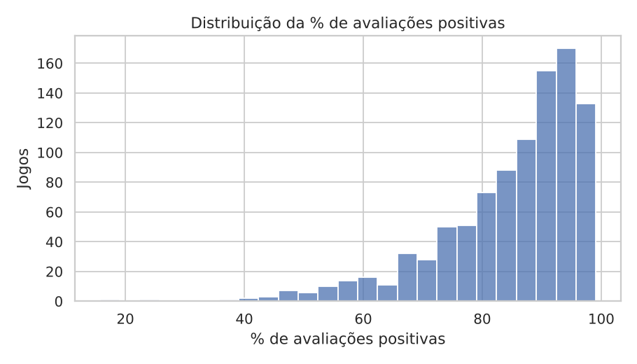
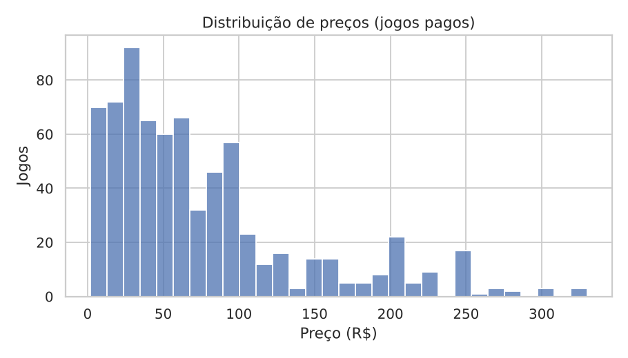
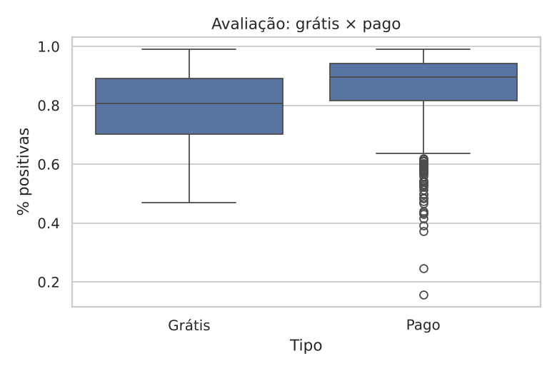
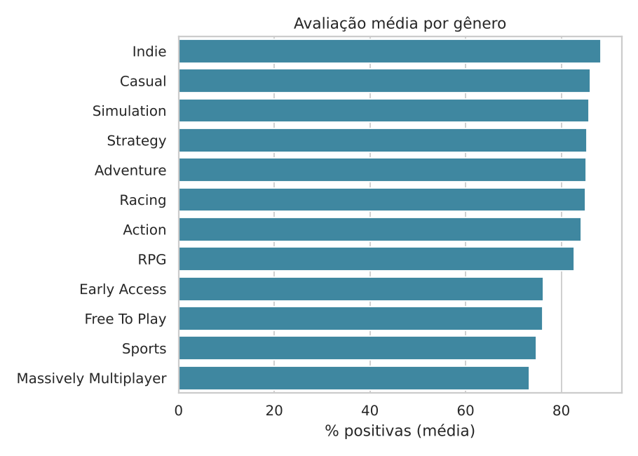
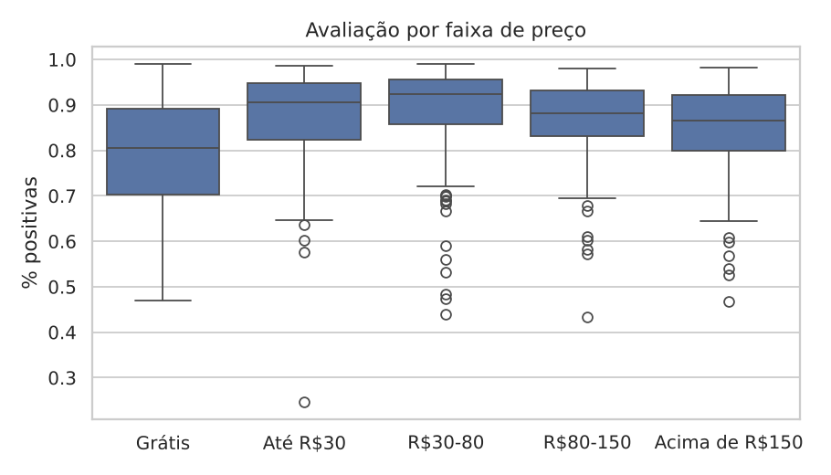
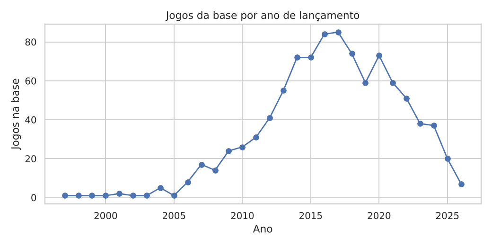
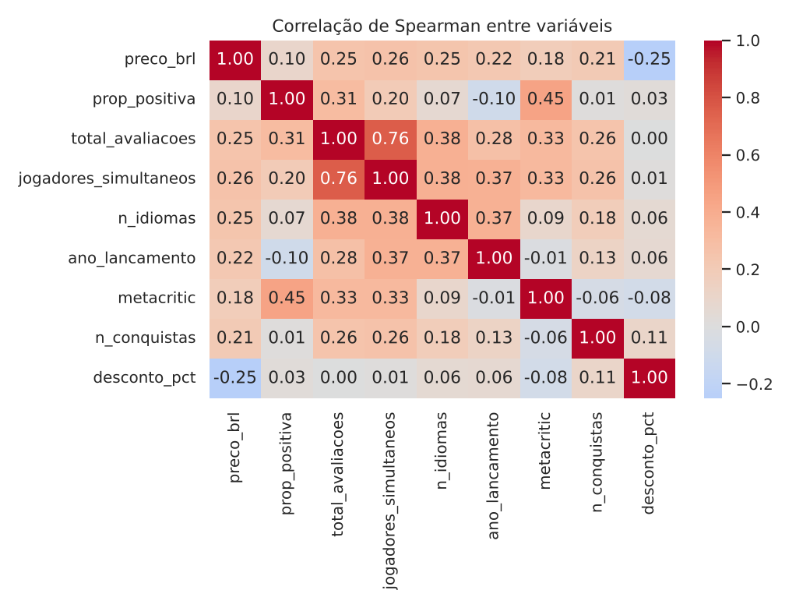
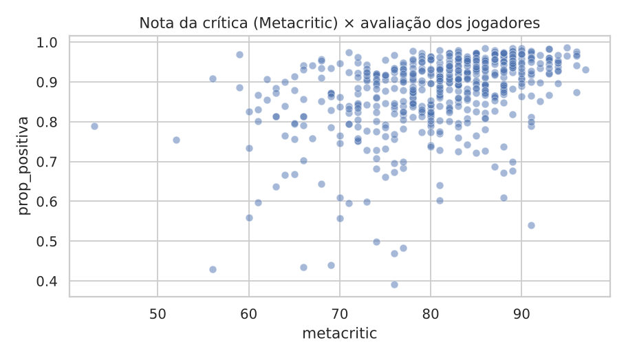

# Resultados da análise exploratória

## 1. Registros
- Jogos analisados: **961**
- Período: 1997 a 2026
- Gratuitos: 149 (16%)

## 2. Estatística descritiva
|                       |   n |     média |   mediana |   mínimo |        máximo |   desvio padrão |
|:----------------------|----:|----------:|----------:|---------:|--------------:|----------------:|
| Preço (R$)            | 874 |     63    |     44.44 |     0    | 329.9         |           66.51 |
| % positivas           | 961 |      0.85 |      0.88 |     0.16 |   0.99        |            0.12 |
| Nº avaliações         | 961 | 109865    |  44497    |    91    |   8.81509e+06 |       341392    |
| Jogadores simultâneos | 961 |   4896.23 |    399    |     0    |   1.01394e+06 |        35966.9  |
| Nº idiomas            | 961 |     10.7  |     10    |     1    | 103           |            7.46 |
| Metacritic            | 544 |     80.62 |     82    |    43    |  97           |            8.15 |

Só jogos pagos (n=725): preço médio R$ 75.95, mediana R$ 57.99.

Assimetria da % positivas: -1.53 (negativo = cauda para a esquerda, a maioria dos jogos é bem avaliada).

## 3. Comparações
### Grátis × pago
| gratuito   |   jogos |   pct_positiva |   mediana_donos |   mediana_jogadores |
|:-----------|--------:|---------------:|----------------:|--------------------:|
| Pago       |     812 |          0.86  |         3.5e+06 |                 381 |
| Grátis     |     149 |          0.786 |         3.5e+06 |                 496 |

Teste de Mann-Whitney (% positivas, grátis × pago): p < 0,001 (diferença significativa a 5%).

### Por gênero (gêneros com 15+ jogos)
| genero                |   jogos |   pct_positiva |   preco_medio |
|:----------------------|--------:|---------------:|--------------:|
| Indie                 |     353 |          0.882 |        40.734 |
| Casual                |     120 |          0.861 |        28.731 |
| Simulation            |     192 |          0.858 |        54.789 |
| Strategy              |     192 |          0.853 |        60.821 |
| Adventure             |     372 |          0.852 |        67.659 |
| Racing                |      28 |          0.85  |        63.386 |
| Action                |     655 |          0.842 |        67.731 |
| RPG                   |     252 |          0.828 |        67.489 |
| Early Access          |      31 |          0.763 |        47.442 |
| Free To Play          |     169 |          0.762 |         0     |
| Sports                |      33 |          0.747 |        59.329 |
| Massively Multiplayer |     115 |          0.733 |        25.483 |

### Por faixa de preço
| faixa_preco    |   jogos |   pct_positiva |
|:---------------|--------:|---------------:|
| Grátis         |     149 |          0.786 |
| Até R$30       |     197 |          0.874 |
| R$30-80        |     270 |          0.894 |
| R$80-150       |     161 |          0.865 |
| Acima de R$150 |      97 |          0.839 |

## 4. Correlação (Spearman) com a % positivas
|                       |    rho |
|:----------------------|-------:|
| ano_lancamento        | -0.096 |
| n_conquistas          |  0.013 |
| desconto_pct          |  0.028 |
| n_idiomas             |  0.066 |
| preco_brl             |  0.096 |
| jogadores_simultaneos |  0.203 |
| total_avaliacoes      |  0.31  |
| metacritic            |  0.451 |

## 5. Top 10 jogos mais avaliados
| nome                           |   total_avaliacoes |   prop_positiva |   preco_brl |
|:-------------------------------|-------------------:|----------------:|------------:|
| Counter-Strike 2               |        8.81509e+06 |           0.867 |        0    |
| PUBG: BATTLEGROUNDS            |        2.55794e+06 |           0.594 |        0    |
| Grand Theft Auto V Legacy      |        1.99056e+06 |           0.874 |      nan    |
| Terraria                       |        1.40947e+06 |           0.975 |       32.99 |
| Tom Clancy's Rainbow Six Siege |        1.39858e+06 |           0.839 |        0    |
| Rust                           |        1.22778e+06 |           0.872 |       59.99 |
| Team Fortress 2                |        1.16147e+06 |           0.899 |        0    |
| Garry's Mod                    |        1.15971e+06 |           0.968 |       25.99 |
| Black Myth: Wukong             |        1.1501e+06  |           0.967 |      229.99 |
| ELDEN RING                     |        1.05668e+06 |           0.929 |      274.5  |
