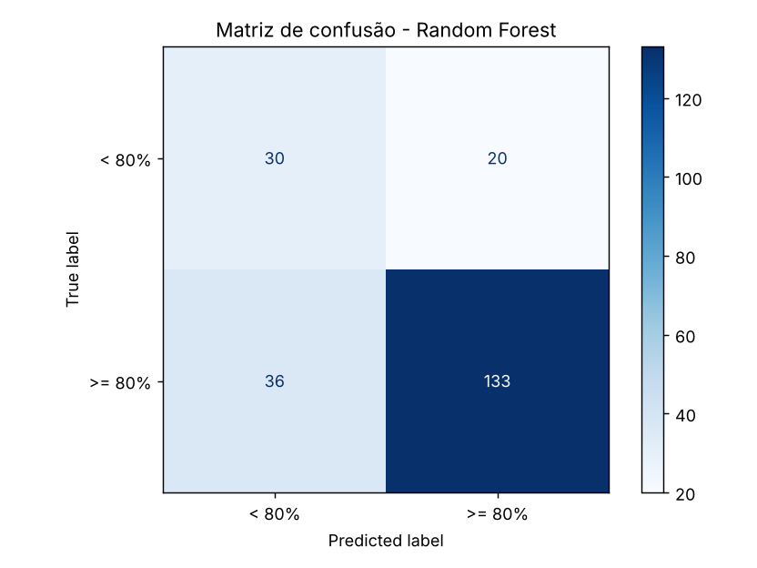
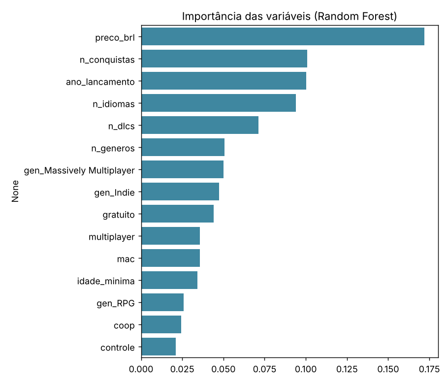

# Resultados de Machine Learning

- Jogos: 874 | classe 1 (>=80% positivas): 673 (77%) | classe 0: 201
- Features (24): preco_brl, gratuito, n_idiomas, n_generos, multiplayer, ano_lancamento, mac, linux, n_conquistas, n_dlcs, idade_minima, controle, coop, gen_Action, gen_Adventure, gen_RPG, gen_Strategy, gen_Simulation, gen_Indie, gen_Casual, gen_Massively Multiplayer, gen_Sports, gen_Racing, gen_Early Access

## Comparação dos modelos (conjunto de teste, 25%)
| modelo                       | F1 macro (CV 5)   |   acurácia |   precisão |   recall |   F1 macro |   ROC AUC |
|:-----------------------------|:------------------|-----------:|-----------:|---------:|-----------:|----------:|
| Baseline (classe mais comum) | 0.435 ± 0.001     |      0.772 |      0.772 |    1     |      0.436 |     0.5   |
| Regressão Logística          | 0.593 ± 0.009     |      0.689 |      0.874 |    0.698 |      0.634 |     0.771 |
| Random Forest                | 0.658 ± 0.024     |      0.744 |      0.869 |    0.787 |      0.672 |     0.767 |


## Relatório do Random Forest
```
              precision    recall  f1-score   support

       < 80%       0.45      0.60      0.52        50
      >= 80%       0.87      0.79      0.83       169

    accuracy                           0.74       219
   macro avg       0.66      0.69      0.67       219
weighted avg       0.77      0.74      0.76       219
```

## Importância das variáveis (top 10)
|                           |   importância |
|:--------------------------|--------------:|
| preco_brl                 |         0.172 |
| n_conquistas              |         0.101 |
| ano_lancamento            |         0.1   |
| n_idiomas                 |         0.094 |
| n_dlcs                    |         0.071 |
| n_generos                 |         0.051 |
| gen_Massively Multiplayer |         0.05  |
| gen_Indie                 |         0.047 |
| gratuito                  |         0.044 |
| multiplayer               |         0.036 |






## Clusterização K-Means (4 perfis)
|   perfil |   jogos |   preco |   jogadores |   idiomas |   pct_positiva |   conquistas | exemplo                                                               |
|---------:|--------:|--------:|------------:|----------:|---------------:|-------------:|:----------------------------------------------------------------------|
|        0 |     299 |  105.94 |        2464 |     14.34 |           0.89 |           54 | Terraria, Rust, Team Fortress 2                                       |
|        1 |     157 |   27.37 |          89 |      3.38 |           0.87 |            0 | Unturned, Lethal Company, People Playground                           |
|        2 |     119 |    3.07 |         656 |     12.45 |           0.74 |           35 | Counter-Strike 2, PUBG: BATTLEGROUNDS, Tom Clancy's Rainbow Six Siege |
|        3 |     299 |   62.63 |         173 |     10.58 |           0.87 |           50 | Tomb Raider Game of the Year, BioShock Infinite, NieR:Automata™       |
